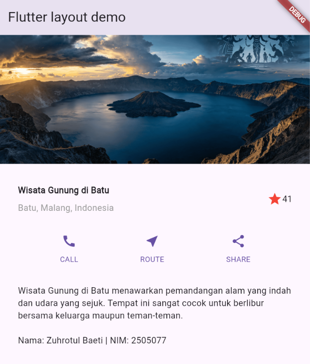

# Laporan Praktikum 1: Layout Flutter

**Nama:** Zuhrotul Baeti  
**NIM:** 2505077  
**Kelas:** D4 Rekayasa Perangkat Lunak  

---

## Deskripsi Aplikasi
Aplikasi ini merupakan hasil pengerjaan Praktikum 1 sampai 4 mengenai tata letak (layout) dan komponen UI di Flutter. Aplikasi ini menampilkan informasi tempat wisata dengan struktur widget seperti `Column`, `Row`, `Container`, `Expanded`, serta daftar yang dapat di-scroll menggunakan `ListView`.

---

## Hasil Tampilan Aplikasi

| Tampilan Utama |
| :---: |
|  |

---

## Penjelasan Komponen Layout

1. **Header Image (`Image.asset`)**:
   - Menampilkan gambar `images/toba.png` yang didaftarkan pada `pubspec.yaml`.
   - Menggunakan properti `fit: BoxFit.cover` agar gambar menyesuaikan area tampilan secara rapi.

2. **Title Section (`titleSection`)**:
   - Memuat nama tempat wisata (*Wisata Gunung di Batu*) dan lokasi (*Batu, Malang, Indonesia*).
   - Menggunakan widget `Expanded` agar kolom teks dapat mengambil sisa ruang yang ada di dalam `Row`.
   - Dilengkapi dengan ikon bintang merah dan teks rating.

3. **Button Section (`buttonSection`)**:
   - Berisi 3 kolom tombol aksi: **CALL**, **ROUTE**, dan **SHARE**.
   - Dibuat menggunakan fungsi pembantu `_buildButtonColumn()` agar penulisan kode lebih efisien.
   - Menggunakan `MainAxisAlignment.spaceEvenly` untuk memberikan jarak rata antar ikon.

4. **Text Section (`textSection`)**:
   - Menampilkan deskripsi lengkap lokasi wisata.
   - Dilengkapi dengan identitas pembuat (Nama & NIM).
   - Menggunakan properti `softWrap: true` agar teks membungkus secara otomatis mengikuti lebar layar.

5. **ListView**:
   - Seluruh elemen disusun di dalam widget `ListView` (sebagai pengganti `Column`) agar tampilan mendukung *scrolling* saat dijalankan di perangkat dengan ukuran layar kecil.